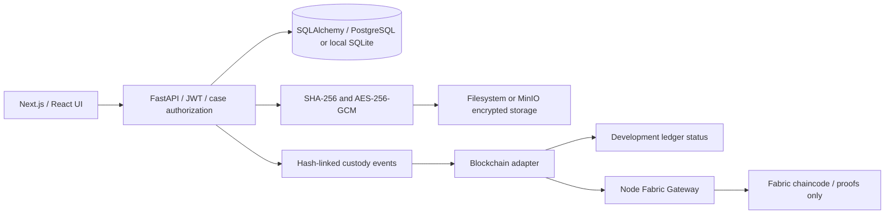

# NyayaVault

> **Backup status — 17 October 2026:** The old `NyayaVault-Windows-Exact.zip` and pre-reset recovery folder have been deleted at the user’s request. References below to that package and its record counts are historical. For a fresh installation, follow [RUN_PROJECT.md](RUN_PROJECT.md). To move current data, export a new private snapshot first.

**How to run:** [RUN_PROJECT.md](RUN_PROJECT.md) — Windows Docker setup, empty startup, login accounts and optional AI/OCR.

**Current local data (17 October 2026):** reset to zero cases, evidence and evidence transactions at the user’s request. Existing accounts and AI/OCR are retained. See [fresh-start details](docs/FRESH_START.md).
### Secure Digital Evidence & Chain-of-Custody Platform

A working B.Tech Phase-II prototype for registering encrypted digital evidence, preserving its original SHA-256 fingerprint, verifying candidate files, transferring custody, and inspecting a tamper-evident audit trail.

## Current tested deployment

**Starting from GitHub on a new computer:** install Docker Desktop with Linux containers, then run `powershell -NoProfile -ExecutionPolicy Bypass -File .\scripts\windows\Start.ps1` on Windows, or `bash scripts/portable.sh start` on macOS/Linux, from this project folder. Open http://127.0.0.1:3001. This creates a fresh demonstration with new keys and transactions. The repository excludes live credentials, encrypted evidence, Fabric identities and private recovery archives; importing an existing deployment requires its separately held private backup.

**Use this running project:** open http://127.0.0.1:3001. To resume it after restarting Docker Desktop, run `bash scripts/start-fabric.sh` from this folder. It uses one NyayaVault deployment with ten required service containers. See [current cleanup and run guide](docs/CURRENT_PROJECT.md).

**Windows / macOS / Linux portability:** follow [WINDOWS_START_HERE.md](WINDOWS_START_HERE.md). The private `NyayaVault-Windows-Exact.zip` is the single retained recovery/transfer package. Use `scripts/windows/Import.ps1` on a fresh computer to preserve its data. Running `Start.ps1` directly on a fresh computer creates an independent demo. The duplicate portable deployment on this Mac was removed during cleanup. No host Python, Node.js or Fabric tools are needed for the Docker paths.

The [portability report](docs/PORTABILITY_REPORT.md) records the executed restore, fresh-install, permissions, real Fabric commit and preservation checks. Windows execution still needs validation on the destination computer.

Read the [full project and test report](docs/FULL_PROJECT_REPORT.md) for the 7 October 2026 validation, how evidence storage and blockchain proofs work, access rules, cleanup, and known limits. The current Docker app is at http://127.0.0.1:3001 and uses the original two-organization Fabric network.

The 8 October refresh replaces the active test dataset with four realistic fictional investigations and twelve training records. See [demo cases](docs/DEMO_CASES.md) and the [executed refresh report](docs/DEMO_REFRESH_REPORT.md). Old test cases are archived: their encrypted originals, custody history and real transaction references remain accessible through **Include archived cases and evidence**.

## Start the local demonstration

Requirements: Python 3.13 and Node.js 22 or later, npm, and Internet access for the initial dependency install.

```sh
cd /path/to/nyayavault
bash scripts/start-local.sh
```

Open http://127.0.0.1:3000. API documentation: http://127.0.0.1:8000/docs.
The script generates fresh secrets only when `backend/.env` is absent, installs dependencies, runs Alembic migrations, and seeds demo users. It preserves existing evidence. Stop with Ctrl+C.

The default local demonstration uses **SQLite and encrypted filesystem storage** as a lightweight option. Docker has since been installed and the PostgreSQL/MinIO backend passed the real HTTP and encrypted-object integration checks documented in `docs/docker-test-results.json` and `docs/docker-storage-results.json`. See [Docker guide](docs/DOCKER_GUIDE.md) for the separate container deployment on ports 3001/8001.

For separate terminals:

```sh
python3 scripts/configure.py
python3 -m venv .venv
.venv/bin/pip install -r backend/requirements.txt
cd backend
../.venv/bin/alembic upgrade head
../.venv/bin/python -m app.seed
../.venv/bin/uvicorn app.main:app --host 127.0.0.1 --port 8000
```

```sh
cd frontend
npm ci
npm run build
npm run start -- --hostname 127.0.0.1
```

The start script uses a production build to avoid filesystem watcher limits encountered on macOS. For development, run `WATCHPACK_POLLING=true npm run dev` instead of build/start.

## Demo credentials

All seeded accounts use the development-only password **`DemoOnly!2026`**:

| Account | Role |
|---|---|
| admin@nyayavault.local | ADMIN |
| investigatorA@nyayavault.local | INVESTIGATOR |
| investigatorB@nyayavault.local | INVESTIGATOR |
| forensic@nyayavault.local | FORENSIC_OFFICER |
| legal@nyayavault.local | VIEWER |

Email matching is case-insensitive. These accounts are intentionally predictable and unsuitable for public or production deployment. The account seed does not create cases or evidence. The practical demo importer registers clearly fictional training files through the real API and records actual verification, custody and Fabric results.

## Problem and solution

Digital evidence can be copied, modified, or handed off without a reliable history. NyayaVault binds the original bytes to an immutable trusted fingerprint, encrypts those bytes off-chain, and records who performed each operation. Verification compares a candidate hash against the original without replacing it. A mismatch is an alert about the candidate; it does not imply the encrypted original was modified.

## Architecture



No original evidence bytes are submitted to Fabric. The Gateway bridge is necessary because the official Fabric Gateway client used here is Node.js. It signs with a configured Fabric service identity and records the application actor separately; it does not pretend every login has its own Fabric certificate.

## Implemented modules

- Argon2 passwords, JWT expiry, database-backed token revocation on logout and role change.
- Server-side roles and per-case membership; administrators see all cases.
- Case creation, status/metadata updates, assignment management, and update audit logs.
- Evidence intake with supported-extension and signature/content checks, 25 MB per-file limit, UUID storage keys, SHA-256, random-nonce AES-256-GCM, and tags.
- Evidence details, original/candidate verification, security alerts, encrypted retrieval and download audit.
- Custody transfer restricted to current custodian/admin and authorized recipients.
- Canonical JSON hash-linked event chains, sequence compare-and-swap, ledger verification, append-only database triggers, immutable fingerprint/storage pointer guards.
- Audit filters, evidence search, real database dashboard counts, Recharts evidence-type chart, and measured timings.
- Local and MinIO adapters, development/Fabric providers, real Fabric Gateway submission code, chaincode, explicit submission failures, and operator replay.
- Explicit Alembic migration, test suites, synthetic sample files, documentation, Docker configuration.

**Case assistant:** optional Google Gemini summaries and question answering over selected text, PDF and scanned-document excerpts, with quoted citations and server-enforced access. See [configuration and limits](docs/AI_ASSISTANT.md). Disabled until a backend API key is configured.

**Not implemented:** Reliable handwriting recognition, document classification, semantic/vector RAG, relationship graph, MFA. These are optional future modules and visibly disabled/not implemented. No AI API key is required for the core evidence workflow.

## Database architecture

`users` → `case_members` ← `cases` → `evidence` → `custody_events`, `verification_logs`.
`evidence` ↔ `evidence_tags` ↔ `tags`. `custody_events` → `blockchain_transactions`.
`audit_logs` records case/user/evidence operations. `ocr_documents` remains unused; the assistant performs local, temporary OCR without persisting derived text.

UUID internal keys are separate from human case/evidence identifiers. Unique identifiers and indexed case, evidence, hash and timestamp fields support lookup. Events include a per-evidence sequence, prior hash, complete-event hash, actor role at event time, custody endpoints and metadata. Trusted original hash and object name cannot be changed through the database guards or API. Migrations are in `backend/alembic/versions/001_initial.py` and contain explicit table/index definitions.

## Security design and limits

AES-GCM stores the 12-byte nonce before ciphertext/tag and binds the evidence UUID as authenticated associated data. Keys live in environment configuration, not the database. Never lose `EVIDENCE_MASTER_KEY`: existing evidence becomes unrecoverable. Back up keys separately from database/object storage. Keys are generated locally, excluded from source control and Docker context, and are not included in the source archive.

The development ledger detects record changes, sequence gaps, and deletions relative to its stored head. A privileged database/filesystem administrator can rewrite all hashes and anchors; this is **not blockchain immutability**. Database triggers defend ordinary mutation, not administrator compromise. Case/user administrative audit records are append-only but are not part of the evidence hash chain.

Frontend tokens use sessionStorage for this local prototype, so an XSS compromise could steal them. Production needs HTTPS, stronger session delivery, managed key rotation/KMS, distributed rate limiting, malware scanning, streaming uploads, durable delivery/reconciliation of Fabric outbox jobs, backups, real user provisioning and operational security review. File signature checks are not a malware scanner. Downloads are attachments, not inline active content. The file-size limit applies while reading each evidence file; a reverse proxy should also limit total HTTP multipart request size.

The app logs successful preparation of an authorized download; it cannot prove that a browser finished saving the response. Verification timings measure backend work, not WAN latency. Lists currently load all authorized records and are suited to a small academic demo, not a large archive. Failed candidate checks affect the displayed latest integrity status, while the attempt history remains preserved.

## Docker / PostgreSQL / MinIO

```sh
python3 scripts/configure-docker.py
docker compose up --build
```

This starts PostgreSQL, MinIO, FastAPI, and Next.js. Ports bind to loopback. MinIO console: http://localhost:9001. Passwords are generated in root `.env`; the application encryption key and JWT secret are passed to the backend. Docker currently seeds the same development accounts deliberately. Do not expose this Compose setup publicly.

PostgreSQL migrations, authenticated API operations, MinIO ciphertext storage/retrieval, and database immutability guards have now been executed successfully. Root `.env` on this machine selects ports 3001/8001 to preserve the original local demo. MinIO is built from pinned official source because the old registry image is no longer available. See `docs/DOCKER_GUIDE.md` and `docker/minio/README.md`.

## Configuration

See `.env.example`. Backend reads `backend/.env` when launched from `backend/`. Docker Compose reads root `.env`.

| Variable | Purpose |
|---|---|
| DATABASE_URL | SQLite demo or `postgresql+psycopg://…` |
| JWT_SECRET / JWT_EXPIRY_MINUTES | Signing secret (32+ chars) and expiry |
| EVIDENCE_MASTER_KEY | Base64 encoding of exactly 32 random bytes |
| STORAGE_PROVIDER / STORAGE_PATH | `local` or `minio`, local directory |
| MINIO_ENDPOINT / ACCESS_KEY / SECRET_KEY / BUCKET / SECURE | Object storage configuration |
| BLOCKCHAIN_PROVIDER | `development` or `fabric` |
| FABRIC_GATEWAY_URL / FABRIC_GATEWAY_SECRET | Local bridge URL and authentication |
| CORS_ORIGINS | Exact allowed frontend origins, comma-separated |
| MAX_FILE_MB | Maximum evidence/candidate file size; default 25 |
| NEXT_PUBLIC_API_URL | Frontend API base; requires rebuild after change |

`FABRIC_CONNECTION_PROFILE` is a documented legacy placeholder; the Gateway uses certificate paths, not this profile. `AI_PROVIDER=gemini`, `GEMINI_API_KEY` and `AI_MODEL` configure the optional case assistant. `AI_API_KEY` remains unused.

## Hyperledger Fabric

See [Fabric setup](docs/FABRIC.md) for network deployment, identity configuration, gateway startup, and proof replay. Network status on the build host (2026-10-06): **CONNECTED**. The two-organization Fabric network committed real custody proofs and passed 28 integration/peer checks. Resume it with `bash scripts/start-fabric.sh`. No invented transaction IDs are generated. Chaincode unit tests use explicitly test-only transaction strings; those are not persisted in the running demonstration.

## Verification

```sh
cd backend
../.venv/bin/python -m pytest -q --junitxml=../docs/test-results.xml
cd ../frontend
npm run typecheck
npm run build
npx playwright install chromium
npx playwright test
cd ../blockchain/chaincode
npm ci
npm test
```

Browser tests require both servers running and an OS environment that allows Chromium. The build host blocked standalone Chromium launch; the provided suite's raw failure report is retained and does not count as a pass. See [test report](docs/TEST_REPORT.md) for all executed checks and browser verification details.

## Demo and results

Follow [DEMO_GUIDE.md](DEMO_GUIDE.md). Test output: `docs/test-results.xml`. Measured acceptance results: `docs/acceptance-results.json`. The dashboard reads live rows, never hardcoded successes. With the Docker Fabric services running, load the practical dataset using `python scripts/populate-demo.py` from an environment with `httpx` installed; see [demo cases](docs/DEMO_CASES.md) for backup and rerun instructions. The importer requires real Fabric connectivity. The lightweight SQLite mode starts with accounts only; create a case there through the application.

Archived cases leave ordinary lists and dashboard totals. The archive toggle retains the same case permissions, and new uploads require restoring an archived case first. Successful runs of the Docker acceptance scripts archive only their own new test case, keeping the ordinary workspace clear.

## Important folders

- `frontend/`: Next.js, TypeScript, Tailwind, Lucide and Recharts interface.
- `backend/app/`: routers, relational models, schemas, security, services, storage, ledger and blockchain adapters.
- `backend/alembic/`: database migrations and integrity guards.
- `backend/tests/`, `frontend/tests/`: automated acceptance/security and browser checks.
- `blockchain/`: Fabric chaincode and Gateway bridge.
- `sample-data/demo-cases/`: four fictional investigations and twelve evidence documents; the original/modified synthetic reports remain fixtures for automated checks.
- `scripts/`: local startup and secret configuration.
- `docs/`: executed results, limitations, architecture and Fabric instructions.

Screenshots from browser validation are in `docs/dashboard-screenshot.png`, `docs/verification-screenshot.png`, and `docs/audit-screenshot.png`. This implementation is an academic prototype; it does not claim legal certification or production forensic readiness.
