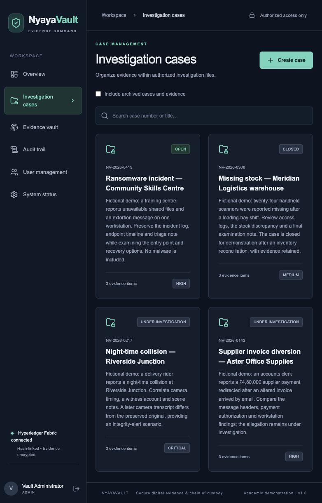

# Practical demonstration refresh — 8 October 2026

NyayaVault now presents four realistic, explicitly fictional investigations and twelve case-specific TXT exhibits. The existing two-organization Fabric network remains in use.

| Case | Investigation | State | Exhibits |
| --- | --- | --- | --- |
| NV-2026-0142 | Supplier invoice diversion — Aster Office Supplies | Under investigation | Email headers, payment summary, mailbox findings |
| NV-2026-0217 | Night-time collision — Riverside Junction | Under investigation | Camera observation transcript, witness note, scene record |
| NV-2026-0308 | Missing stock — Meridian Logistics warehouse | Closed | Access log, reconciliation, examination note |
| NV-2026-0419 | Ransomware incident — Community Skills Centre | Open | Response log, endpoint timeline, triage note |

These are invented training scenarios. The evidence documents are text records, not real camera footage, official police records or malware. Upload and workflow timestamps and Fabric transactions are actual execution results, separate from the fictional collection dates.

## What changed

- Loaded all twelve originals through the application upload API, encrypted them in MinIO, verified eleven stored originals, performed seven forensic handoffs and detected one deliberately changed camera timestamp.
- The final states are ten verified, one integrity alert and one unverified witness note. The camera's original remains unchanged even though the candidate comparison failed.
- Archived the five inspected test cases and their five exhibits out of ordinary case, evidence, dashboard and audit views. The archive checkbox exposes them under the same case permissions.
- New uploads to archived cases require restoring the case. Existing access, custody and verification behavior remains available to authorized users.
- Account seeding no longer recreates a generic case. The practical importer creates new demo data using real operations and resumes matching records without duplicate workflow events.
- Successful integration test scripts archive only their own newly created test case. Their revised cleanup was syntax-checked; these scripts were not rerun against the live practical workspace.

## What was preserved

The original five users, account roles, case content and memberships remain. The five old encrypted originals, SHA-256 fingerprints, full custody events, ledger anchors and original transaction references were compared against a private pre-change baseline. The encryption configuration matches its backup byte for byte. No ledger reset, old evidence replacement, transaction replay or fabricated transaction ID occurred.

A PostgreSQL logical dump, encrypted MinIO-object archive and the existing Docker encryption/configuration keys were saved under private `blockchain/runtime/backups/demo-refresh-20261008/` before import. The importer separately saved its private record/history baseline. Fabric identities and existing ledger volumes were retained. This supplementary backup was not tested as a complete Fabric disaster-recovery restore.

## Executed results

- **22 backend tests passed**, including role/member restrictions, archive visibility, unchanged custody history, restoring cases and rejecting uploads to archived cases.
- **468 import checks passed** against the live API. All twelve originals and all 31 new workflow events have real committed Fabric transaction references.
- **13 read-only preservation/network checks passed**. Every one of the 17 stored originals decrypts and hashes correctly; all 70 custody events match real Fabric history. All 39 original transaction references remain unchanged.
- Both peers report Org1MSP and Org2MSP chaincode approvals. The shared channel retains both organizations and majority endorsement, requiring the two organization policies.
- **Seven manual browser checks passed** for login, dashboard totals, active/archived case and evidence lists, and the final active workspace.
- Backend and frontend Docker builds passed; the frontend build completed its TypeScript validation. The backend was rebuilt after adding the archived-upload guard and account-only seed.

The importer was also rehearsed against an isolated simulated API: rerunning caused zero writes, and a conflicting original fingerprint stopped it before mutation. This rehearsal is separate from the actual live import and peer proof checks.

## Evidence of execution

- [Live import and actual transaction references](demo-refresh-results.json)
- [Encrypted-original and real Fabric history comparison](demo-preservation-results.json)
- [Browser checks](demo-browser-results.json)
- [Backend test report](TEST_REPORT.md)
- [Presentation guide](../DEMO_GUIDE.md) and [scenario/importer instructions](DEMO_CASES.md)

