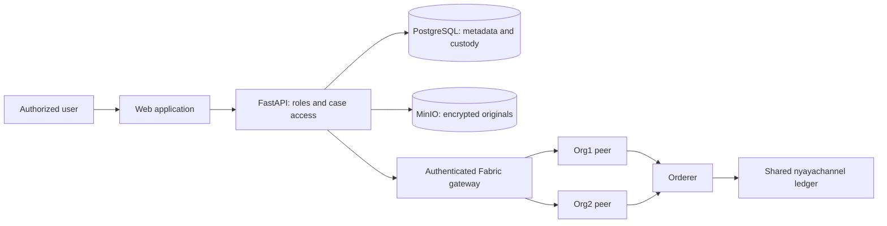
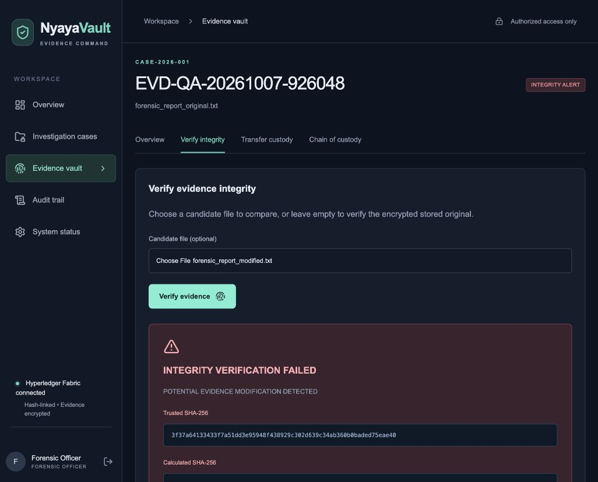

# NyayaVault — full project and test report

**8 October portability update:** a standalone Docker deployment and Windows transfer/startup scripts are now available. The original data and transaction IDs were verified in an isolated imported copy, and a fresh independent demo passed live checks. See [PORTABILITY_REPORT.md](PORTABILITY_REPORT.md) for current execution evidence and Windows test limits. The dated report below describes the original deployment.

**Validated: 7 October 2026 (India time)**
**Result: the local two-organization demonstration is working.**

NyayaVault preserves uploaded file bytes in encrypted storage, records who handles the evidence, detects files that differ from the original, and commits custody proofs to a real Hyperledger Fabric ledger. The cancelled one-organization migration was never applied. Org1MSP and Org2MSP remain members of the same channel.

The current tests produced **80 passing automated tests/checks across six groups**, plus **10 browser workflow observations**. These counts include overlapping coverage; they are not 90 independent security guarantees. The frontend production build, TypeScript check, gateway syntax check and Compose validation also passed. This is a functional academic demonstration, with the limitations below.

## 1. What is running

| Component | Purpose | Current configuration |
|---|---|---|
| Web application | Login, cases, evidence, verification, transfers, audit and dashboard | Next.js / React; http://127.0.0.1:3001 |
| Backend | Permissions, file processing, database writes and blockchain submissions | FastAPI; API documentation at http://127.0.0.1:8001/docs |
| Database | Users, cases, file metadata, custody, audit and transaction status | PostgreSQL |
| File storage | Encrypted original evidence objects | MinIO; console at http://127.0.0.1:9001 |
| Fabric gateway | Signs and submits proofs, checks commits, queries history | Internal Node service using an Org1 service identity |
| Fabric peers | Execute the contract and maintain the shared ledger | One Org1MSP peer and one Org2MSP peer |
| Orderer | Orders transactions into blocks | One Raft orderer |
| Chaincode | Preserves original fingerprints and linked proof history | `nyayavault` version 1.0, sequence 1 |
| Shared channel | Carries the same evidence-proof ledger for both organizations | `nyayachannel` |

Docker Desktop groups eight main services under **nyayavault**. Fabric automatically runs two additional contract containers. All ten containers were running during the final check. Current endorsement is a majority of the two application organizations, so a normal write requires both organizations' endorsements. Both peers confirmed the deployed definition and both approvals.

Police, forensic and reviewer accounts use the same application. Backend roles and case assignments determine their permissions. An application user is not automatically a separate Fabric organization or certificate holder. The gateway signs using its service identity and separately records the acting user's identifier.



The separate lightweight SQLite/filesystem demonstration can still be started on ports 3000/8000. Its database, storage and encryption settings are distinct from the Docker deployment tested here.

## 2. How evidence moves through the system

### Sign in and case access

Passwords are checked against Argon2 hashes. The backend issues a signed JWT with a 60-minute default lifetime and checks the user's current token version on each authenticated request. Logout invalidates existing tokens for that account. Case membership limits what non-administrators can view. An administrator can see all cases.

### Register original evidence

1. The backend checks the user's role and case membership, validates the evidence ID, reads the file within the configured 25 MB limit, and checks the supported file format.
2. It computes SHA-256 from the original bytes. This becomes the trusted fingerprint.
3. It encrypts those bytes with AES-256-GCM using a fresh 12-byte nonce. The evidence UUID is authenticated additional data, binding the encrypted object to its evidence record.
4. MinIO receives only the encrypted object. PostgreSQL receives metadata, the trusted hash, uploader, current custodian, timings and the first custody event.
5. A proof containing the original hash, action, actor, timestamp, case/evidence references and linked event hashes is submitted through the gateway.
6. The gateway checks Fabric commit success before the app marks the transaction **COMMITTED** and saves its real transaction ID.

The original file itself is not stored on the blockchain. Supported extensions are TXT, PDF, PNG, JPEG, DOCX and MP4; file-signature checks do not provide malware scanning or comprehensive document validation.

### Verify integrity

For a candidate file, NyayaVault hashes its bytes and compares the result with the original trusted fingerprint. For the stored original, it first downloads and authenticates/decrypts the encrypted object, then compares its hash. A match records `INTEGRITY_VERIFIED`; a mismatch records `INTEGRITY_FAILED` and an integrity alert. A damaged encrypted object fails AES-GCM authentication.

A candidate mismatch does not replace the original file or its trusted hash. The current status reflects the latest verification; previous alerts remain in the append-only history even if a later verification succeeds. A hash match establishes byte equality, not whether the content is factually true or was lawfully collected.

### Transfer custody

The current custodian or an administrator can transfer evidence to an assigned case member with a custody-capable role. The application records the sender, recipient, reason, timestamp, original evidence hash and previous event hash, then submits the proof to Fabric. Previous custodians lose authority to make another transfer unless they regain custody or have administrator rights.

### Inspect history and download

Each custody event incorporates the previous event's hash. Database guards reject changes to the original fingerprint and past custody records. Audit records describe access, verification, download and transfer activity. Downloads authenticate the encrypted object and recheck its SHA-256 before returning the original bytes.

Viewing evidence details itself records an access event; navigating among evidence pages can therefore add genuine custody/audit entries. UI transaction IDs come from stored submission records. The dedicated peer checks in this review independently queried Fabric and compared those records; the ordinary `/blockchain` evidence endpoint currently returns local custody/transaction data rather than doing a fresh peer comparison.

### When Fabric is unavailable

The application database commits before the external blockchain submission. A failed submission remains visible as **FAILED**; the app does not invent a transaction ID. An operator must use the replay command to retry events in order. Replaying an already committed event returns the original proof's transaction ID and does not add another evidence-history entry. There is no automatic durable retry worker yet.

## 3. Current role rules

Case membership applies to non-administrators throughout this table.

| Action | Administrator | Investigator | Forensic officer | Viewer / legal reviewer |
|---|---|---|---|---|
| See case/evidence metadata | All cases | Assigned cases | Assigned cases | Assigned cases |
| Create cases | Yes | Yes | No | No |
| Change case assignments | Yes | Own cases | No | No |
| Upload evidence | Yes | Yes | Yes | No |
| Verify candidate or stored original | Yes | Yes | Yes | Yes, currently allowed by backend |
| Download original | Yes | Yes | Yes | No |
| Transfer custody | Yes; recipient must be assigned | If current custodian | If current custodian | No |
| Manage users and roles | Yes | No | No | No |

Verification is not a read-only action: it creates a verification/custody record and updates the current integrity status, including when performed by an assigned viewer. This report describes the implemented rule; it has not silently changed that permission.

## 4. Executed tests and results

| Test group | Result | What it covered | Evidence |
|---|---|---|---|
| Backend automated suite | 21 passed | Authentication, expired/revoked tokens, assignments, uploads, duplicates, formats/size, encryption, download, original/modified verification, corruption, immutable hashes, append-only events, custody permissions, storage/Fabric failures | `test-results.xml`, `TEST_REPORT.md` |
| Chaincode unit suite | 3 passed | Original proof immutability, event sequence/idempotence, organization authorization | `chaincode-tests.tap` |
| Real Docker API workflow | 24 passed | PostgreSQL/MinIO upload, verification, transfer, tamper detection, download, access denial, audit/dashboard, logout and committed IDs | `fabric-test-results.json` |
| Real peer and gateway checks | 4 passed | Peer proof/hash/ID consistency, replay behavior, rejected fingerprint replacement, gateway authentication | `fabric-peer-results.json` |
| Storage/database checks | 4 passed | Ciphertext differs from plaintext; decryption matches trusted hash; PostgreSQL blocks hash changes and history updates | `docker-storage-results.json` |
| Extended live role/network checks | 24 passed | Forensic/viewer permissions, police-to-forensic handoff and return, previous-custodian denial, all-evidence integrity, both peers, channel membership and endorsement rule | `live-system-results.json` |

Additional verification:

- Production frontend build: passed. TypeScript validation: passed, including the adjusted standalone browser-test configuration.
- Gateway JavaScript syntax and combined Compose configuration: passed.
- Frontend, gateway and chaincode npm audits: each reported **zero known vulnerabilities** for its lockfile at test time. Python packages, container operating systems and the application as a whole were not comprehensively security-audited.
- Browser: invalid password feedback, valid login/dashboard, upload, visible committed IDs, stored-original verification, transfer to forensic officer, forensic access, altered-file detection, audit search and connected system status were observed successfully. No browser warning/error entries were captured during this run.
- The previous standalone Playwright launcher failed under macOS permissions. That historical failure is retained and is not counted as a passed suite. This run used Codex browser controls against the actual Docker frontend. The standalone suite's base URL now defaults to port 3001 and supports `NYAYAVAULT_TEST_URL`; that launcher was not rerun here.
- Two non-failing Python deprecation warnings remain: FastAPI/Starlette test-client HTTP dependency usage and Alembic's legacy path separator configuration.

The browser tested synthetic evidence `EVD-QA-20261007-926048`. Its registration transaction is `3bb13f040cc9f69afa38a6111974cdda612c3f387ebd05a747d943d7954ef3b8`. Its forensic mismatch transaction is `5a1bbf5dfa592b2de7ba7d11198fc089bac5358a03cc3463386250e8e6b11068`.



## 5. Final data consistency

After the browser workflow, an independent read-only check covered **all five stored evidence records and all 35 custody events** in the Docker deployment. Each original decrypted correctly, each plaintext hash matched its trusted fingerprint, every application custody chain was valid, and every event's hash, previous hash and transaction ID matched Fabric history. Five users and five cases were present. See `deployment-final-state.json`.

This run created two clearly labelled synthetic test cases and three synthetic evidence records (API, permissions and browser checks), plus their audit events. These have been retained as test evidence; deleting their records would conflict with the append-only history. Existing records were not deleted, reset, re-encrypted or relabelled. Test logins and logout generated normal account/audit activity.

## 6. Measured performance

One API workflow with the 287-byte sample took **12.827 seconds** overall. Its upload took **2,187.722 ms**, including a **2,082.46 ms** Fabric submission. SHA-256 took **0.005 ms**, encryption **0.804 ms**, and the database stage **14.667 ms**. The six Fabric submissions in that workflow took approximately **2.04–2.08 seconds** each.

Original candidate verification measured **1.219 ms** and modified candidate verification **1.695 ms** for backend comparison work; these timings exclude the subsequent Fabric commit and full browser round trip. These are small-file local measurements, not load, concurrency or large-file benchmarks.

## 7. Cleanup performed

Removed **122,968,351 bytes (117.3 MiB)** across 18 generated/scratch paths: the regenerated frontend build cache, Python/test caches, TypeScript incremental state, completed Fabric install/build/start logs and temporary migration/organization helper files. Exact paths and sizes are recorded in `cleanup-results.json`.

Docker already had no stopped containers and no build cache. All ten containers were required and active, so no running service, image or data volume was removed in this cleanup. The current image set includes Fabric's required runtime/build dependency and application restart images; these were preserved.

Preserved source, tests, usable frontend build, installed dependencies, database/evidence volumes, the local SQLite demonstration, Fabric identities and ledger, original transaction references, root/backend settings and encryption keys. The settings files were checked for byte-for-byte equality across cleanup.

The partial backup from the cancelled one-organization migration is retained and explicitly labelled **INCOMPLETE**. It contains a database dump and container inventory, not a complete validated network recovery snapshot. It must not be treated as a full backup.

Outdated statements saying Fabric was disconnected were corrected in the demonstration and report documentation. The source ZIP was refreshed and excludes secrets, identities, evidence, databases, dependencies and build output; it is source distribution, not a backup of the running system.

## 8. How to run and demonstrate it

From the NyayaVault project directory with Docker Desktop running:

```sh
bash scripts/start-fabric.sh
bash scripts/docker.sh ps
```

Open http://127.0.0.1:3001. The local seeded accounts use `DemoOnly!2026`: `admin@nyayavault.local`, `investigatorA@nyayavault.local`, `investigatorB@nyayavault.local`, `forensic@nyayavault.local`, and `legal@nyayavault.local`. These are demonstration credentials.

A useful demonstration is: sign in as investigator A → select an assigned case → upload the original sample → inspect its real committed ID → verify the stored original → transfer to forensic → sign in as forensic → verify the modified sample → inspect the integrity alert and audit trail → open System status.

To stop and preserve data:

```sh
bash scripts/docker.sh stop
```

Do not use volume deletion or the Fabric sample `network.sh down` as routine cleanup. Keep root `.env`, the private runtime identities and the Docker volumes together in a properly tested backup strategy.

To retry failed blockchain submissions explicitly:

```sh
bash scripts/docker.sh exec -T backend python -m app.retry_blockchain
```

To repeat the current live test groups, use a Python environment with backend dependencies (`../../work/venv/bin/python` is available on this host):

```sh
NYAYAVAULT_TEST_PROVIDER=fabric ../../work/venv/bin/python scripts/smoke-docker.py
../../work/venv/bin/python scripts/check-fabric-history.py
../../work/venv/bin/python scripts/check-live-system.py
```

The first and third commands create new synthetic cases/evidence. The peer script must follow the workflow script so its expected events correspond to the current report.

## 9. Remaining limits and recommended next work

1. **Recovery:** create and test a consistent full backup/restore procedure covering PostgreSQL, MinIO, the encryption key, Fabric identities and both ledger volumes. The partial migration backup is insufficient.
2. **Blockchain delivery:** add a durable retry/reconciliation worker; currently failed events require an operator command. Timeouts after a successful commit are possible, which is why idempotent replay matters.
3. **Trust and identity:** all services run on one machine with sample certificates and one gateway signing identity. Two organizations here do not establish independent institutional control. Roles/case membership are enforced by FastAPI, and the on-chain actor is an application attestation.
4. **Session/deployment security:** this localhost prototype uses browser sessionStorage tokens, predictable demo users and a shared encryption key. Production needs appropriate session delivery, TLS, managed keys/rotation, provisioning and an independent security review.
5. **Large files and hostile inputs:** uploads are processed in memory, signature checks are limited, and malware scanning is absent. Large-file throughput, concurrent custody updates, sustained load and multi-host failures were not stress-tested.
6. **Permissions/product decisions:** decide whether viewers should be allowed to record verification results. The present backend permits this for assigned evidence. The report exposes that behavior without changing it.
7. **Optional features:** OCR, classification, RAG assistance, relationship graphs and MFA are not implemented. Disabled labels accurately reflect that status.

The tested core workflow is ready for a local academic demonstration. The results do not establish production readiness, forensic certification, legal admissibility or complete protection from a host administrator.

## 10. Practical demo refresh — 8 October 2026 (India time)

The preceding sections are the historical 7 October validation snapshot. The later practical demonstration refresh is documented in [Demo cases and evidence](DEMO_CASES.md), including the fictional scenarios, sample files, case assignments, and executed refresh checks. Those fictional records are intended to resemble everyday investigation workflows and do not describe real people or incidents.

Older technical test cases are archived out of the default cases, evidence, audit and dashboard views. Authorized users can include archived cases to inspect their original evidence, custody history and transaction references. Archival preserves encrypted originals and existing ledger entries; it does not delete or recreate past Fabric transactions.

The live workflow and role/network scripts now archive only the new test case created by their own successful run, retaining its assignments and evidence. Their reports capture the workflow and custody state before archival and record the archival result separately. A failed run remains available for diagnosis. This script change was syntax-checked; the historical test counts above are not results from rerunning the revised scripts.

The refresh completed: four active cases, twelve active exhibits, 31 new committed workflow events, seven forensic handoffs and one deliberate candidate mismatch. All 17 encrypted originals and 70 Fabric events passed independent checks, including all 39 original transaction references. All 22 backend tests, 468 import checks, 13 read-only preservation/network checks and seven manual browser checks passed. See the [executed practical refresh report](DEMO_REFRESH_REPORT.md) for preserved data, backups, exact results and screenshot.
