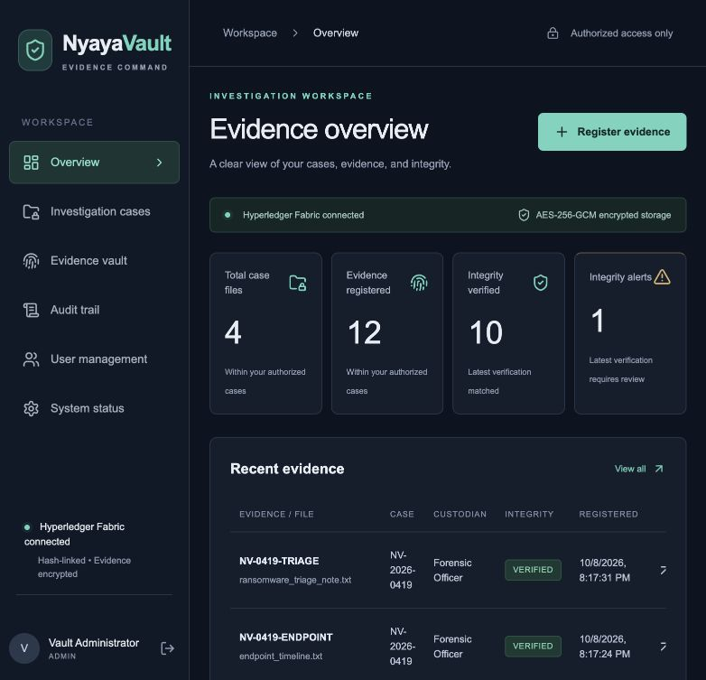

# NyayaVault portability and preservation report

This records the completed portability validation. Subsequent cleanup removed the duplicate test deployment and source-only ZIP; the exact-transfer ZIP remains the single recovery package. See [current project guide](CURRENT_PROJECT.md) for the current layout.

Validated on 8 October 2026 using Docker Desktop on macOS / Apple Silicon (Linux arm64 containers).

NyayaVault now has a standalone Docker setup and Windows PowerShell entry points. The private exact-transfer package contains the current project and a verified snapshot of the original deployment. The source-only package starts a new independent demonstration. Native Windows execution has not been tested on a Windows computer; the destination must complete the import checks before its operation is considered verified.

## What changed

- `docker-compose.portable.yml` groups ten services under **nyayavault-portable**: web app, backend, PostgreSQL, MinIO, gateway, two peers, one orderer and two contract services. It creates its own named data volumes and internal network.
- Fabric initialization, channel setup and contract deployment run inside Linux Docker containers. Destination-native images are built for amd64 or arm64; no Mac Fabric binaries, Node modules or Python environment are carried over.
- Both organizations remain on **nyayachannel**. Writes require **both Org1MSP and Org2MSP peer endorsements**. Roles and case permissions remain enforced by the backend.
- The same contract runs as separate chaincode services. Regular application, peer and contract services do not mount Docker's control socket. Explicit transfer/verification helpers use it for local container and volume operations.
- Windows scripts provide **Import, Start, Stop, Status, Test and Export**. Equivalent shell entry points support macOS, Linux and WSL. The configuration file keeps its original keys across starts, and inherited host settings cannot override it.
- Start rebuilds service images and recreates service containers while retaining named volumes. Bootstrap waits for the orderer's channel leader, retries recognized temporary failures, and checks whether a lifecycle transaction already committed before resubmitting.
- Demo initialization runs only once, resumes incomplete demo imports, and skips existing user workspaces. Imported deployments carry a marker that prevents reseeding.
- Export pauses writers, verifies the source, saves a PostgreSQL dump and encrypted storage/ledger archives, and restarts the source. Restore checks archive hashes and refuses to overwrite an existing deployment or populated volumes.

## Preserved in the exact package

| Original data | Preserved |
|---|---:|
| Users, roles and password hashes | 5 |
| Case records | 9 — 4 active and 5 archived |
| Case memberships | 38 |
| Encrypted original evidence objects | 17 — 12 active exhibits and 5 archived |
| Custody events and original Fabric transaction references | 70 |
| Verification records | 24 |
| Audit records at the snapshot | 117 |
| Fabric identity/certificate/signing-key files | 134 |

The encryption key, object ciphertext, original SHA-256 fingerprints, custody event hashes and timestamps, user/case IDs, and every original transaction ID match the source snapshot. The source database was copied with all tables, including tags and assignments. Historical test records remain archived because their blockchain transactions cannot be erased without destroying the ledger.

The original Mac deployment remains at **http://127.0.0.1:3001**, using contract version **1.0**, sequence **1**. Its network was inspected, paused for the snapshot, restarted and independently checked. It was not reset or upgraded. The private snapshot includes all original Fabric volume archives and additional legacy configuration material for recovery.

On the imported copy, portability requires a documented **contract lifecycle upgrade** to version **1.0-portable**, sequence **2**. This changes how the unchanged contract is launched; it keeps the contract name, ledger and world state. Both organizations approve the upgrade. These are new administrative transactions. No old evidence event is replayed, backdated or presented as a newly generated original proof. Repeated starts keep sequence 2. A fresh independent demo starts at sequence 1 with its own real transactions.

## Executed checks

| Check group | Result | Evidence |
|---|---|---|
| Original source after transfer | 19 / 19 passed | [Final source preservation](portability-final-source-results.json) |
| Imported copy before workflow tests | 19 / 19 passed | [Initial restore comparison](portability-restore-results.json) |
| Imported copy: uploads, permissions, verification, download, custody and commits | 27 / 27 passed | [Live workflow results](portability-workflow-results.json) |
| Same Docker helper operation used by Windows Test.ps1 | 27 / 27 passed | [Container workflow results](portability-container-workflow-results.json) |
| Imported copy after workflow, export and repeated start | 19 / 19 passed | [Final preservation comparison](portability-final-preservation-results.json) |
| Fresh independent four-case demo through real APIs | 383 / 383 passed | [Fresh demo results](portability-fresh-demo-results.json) |
| Fresh demo storage, proofs and unchanged records after initialization | 19 / 19 passed | [Fresh preservation checks](portability-fresh-results.json) |
| Damaged snapshot and populated-target refusal | 4 / 4 passed | [Transfer safety checks](portability-transfer-safety-results.json) |
| Original identities, source/copy peer definitions, first startup, repeat startup and export | 8 / 8 passed | [Startup and identity checks](portability-startup-results.json) |

The groups overlap and are not independent security guarantees. The two live workflow runs added two explicitly synthetic test cases and twelve actual custody/Fabric transactions to the isolated imported test copy, then archived those test cases. That copy has 11 cases, 19 evidence objects and 82 custody events in total; its normal workspace still shows 4 cases and 12 exhibits. The delivered exact snapshot comes from the original source and retains **9 / 17 / 70**, so those additional test records are not imported onto Windows.

Live tests verified unauthorized access denial; assigned-user restrictions; current-custodian transfer rules; correct original hashing; AES-256-GCM storage/decryption; original and stored-file verification; altered-candidate detection without changing the trusted fingerprint; authorized download equality; valid linked custody history; audit records; logout revocation; and real **COMMITTED** Fabric transactions.

All portable images built successfully. Compose configuration, shell/Python syntax, policy decoding and temporary-startup failure handling were checked. Both amd64 and arm64 are listed by the official Fabric 2.5.16 peer/orderer image manifests. Only arm64 was executed here. The browser verified login, the four preserved investigation cards and dashboard totals of 4 cases, 12 exhibits, 10 verified items and 1 integrity alert.

## Packages and practical limits

**NyayaVault-Windows-Exact.zip** includes source plus `transfer/current`: database, encrypted originals, original ledgers and private keys. Keep this ZIP private. **NyayaVault-Windows-Source.zip** excludes live configuration, secrets, data, host dependencies and blockchain runtime. It creates a new demonstration when Start runs. ZIP integrity and snapshot hashes are checked during packaging; Import checks the snapshot hashes again.

Follow [WINDOWS_START_HERE.md](../WINDOWS_START_HERE.md) on a supported Docker Desktop Windows system using its Linux / WSL 2 engine and a local NTFS folder. Initial builds require internet access. This package does not include an offline image cache. PowerShell 5.1 scripts were reviewed, but native Windows, Windows file sharing and amd64 execution remain destination-side checks. Keep the source machine and private snapshot until those checks pass.

The app remains a local academic demonstration. Portability adds no OCR, AI search, MFA, production hardening or forensic certification. Stop keeps data; deleting Docker volumes removes it. The separate source computer and frozen transfer snapshot provide recovery.

After validation, the two independently generated temporary test networks were removed. The imported validation copy was stopped with its recovery volumes retained. The original app remains running on port 3001.
